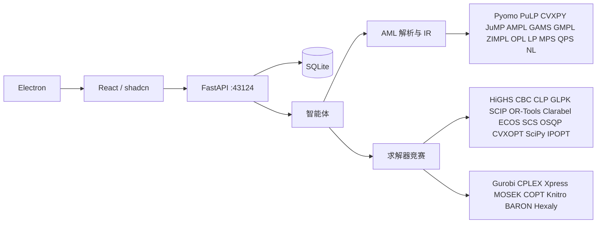

# 公理 Axiom

公理是一套本地优先的数学建模工作室。你用中文或英文描述一个生产计划、运输、排班、指派、非线性或排队问题，智能体把它写成 Axiom 建模语言（AML），并行调用开源求解器，校验结果，并给出灵敏度、情景、蒙特卡洛和可导出的报告。界面默认简体中文，可切换英文。

桌面壳用 **Electron**。打包链成熟，Windows、macOS 和 Linux 的安装器都有现成目标，也不依赖本机 WebKitGTK 或某一版 Rust。求解在 Python 侧车里，界面和求解器可以分开升级。同一套网页界面也可以不打开 Electron，单独用浏览器访问。

## 架构



更细的说明在 [docs/architecture.md](docs/architecture.md)、[docs/aml-spec.md](docs/aml-spec.md)、[docs/solvers.md](docs/solvers.md)、[docs/analysis.md](docs/analysis.md)、[docs/agents.md](docs/agents.md) 和 [docs/lifecycle.md](docs/lifecycle.md)。以后才会做的能力在 [ROADMAP.md](ROADMAP.md)。

## 环境

- Python 3.11+（开发机用 3.12）
- Node.js 22+
- 可选系统求解器：`coinor-cbc`、`glpk-utils`。Linux 上的 IPOPT 需要 `coinor-libipopt-dev` 后再 `pip install cyipopt`（没有 Windows 轮子）。HiGHS、SCIP、GLOP、CP-SAT、Clarabel、ECOS、SCS、OSQP、CVXOPT 随 Python 依赖安装。商业求解器只在本机已授权时启用。详见 [docs/solvers.md](docs/solvers.md)。

```bash
cd backend
python3 -m venv .venv
.venv/bin/pip install -e ".[dev]"
# 有 Ipopt 开发库时再装： .venv/bin/pip install cyipopt

cd ../frontend
npm install
```

演示账号在第一次启动时写入：`demo` / `demo1234`。数据在 `backend/data/`。模型密钥按提供方加密存在同一目录，仓库里没有密钥。不配置外部模型时，离线规则照常建模。设置里的模型提供方覆盖国内、国际、聚合和本地接口，说明见 [docs/providers.md](docs/providers.md)。问题生命周期从自然语言受理到归档：看板、版本差异、求解对比和问题包都在「生命周期」页，说明见 [docs/lifecycle.md](docs/lifecycle.md)。

## 运行

两个进程都要开着。端口故意避开 3000、5173 和 8080。

```bash
# 终端 1
cd backend
PYTHONPATH=. .venv/bin/python -m uvicorn axiom.main:app --host 127.0.0.1 --port 43124

# 终端 2
cd frontend
npm run dev
```

浏览器打开 [http://127.0.0.1:43123](http://127.0.0.1:43123)。登录后可以打开「产品组合示例」，或粘贴下面这段话再点「开始求解」：

> 一家工厂生产产品A和产品B。产品A单位利润40元，产品B单位利润30元。生产一件A需要2小时机器时间和3公斤原料，生产一件B需要3小时机器时间和1公斤原料。每周机器时间不超过120小时，原料不超过90公斤。请制定利润最大的生产计划。

正确的产量约为 A 21.43、B 25.71，利润约为 1628.57。默认会在理解和模型两处停下来等你批准；打开「自动批准」则直接跑完。结果页可以导出 Pyomo、LP，以及 Markdown、PDF、Excel。

同一套界面还可以导入 CSV/Excel、在表格里改参数、诊断不可行、在长时间求解时通知你、自动保存草稿、做假设分析、比较两次求解并回滚模型版本、看一句算法建议、从行业模板试解，以及一键打包模型、数据和报告。说明见 [docs/studio-ux.md](docs/studio-ux.md)。

结果页的图按论文版式排：浅色衬底、衬线刻度、图题与「图 n / Fig. n」说明。除变量、情景和灵敏度跨度外，还有龙卷风图、影子价格、二维可行域、松弛直方图、情景相关、求解器时间–目标，以及双目标时的 Pareto 前沿。每张图可导出 300 dpi 等效的 PNG、SVG，并复制 LaTeX 图环境；PDF 报告里附带带图题的条形图。说明见 [docs/figures.md](docs/figures.md)。

工具栏可以选择算法：单纯形、内点法、分支切割、CP-SAT、加权和、局部搜索和行生成，也可以保持自动并让求解器竞赛。SOS1 和分段线性会先化成线性行再进入标准方程。说明见 [docs/algorithms.md](docs/algorithms.md)。

桌面开发壳（43124 被占用时会改绑一个空闲端口，再把这个地址交给界面）：

```bash
cd frontend
npm run desktop
```

## 测试

```bash
cd backend
PYTHONPATH=. AXIOM_SKIP_EXAMPLE=1 .venv/bin/python -m pytest
cd ../frontend
npm test
npm run build
npx playwright test
```

## 打包

Windows 安装包和便携版自带 Python 3.12、轮子和 GLPK，不调用系统 Python。离线重建见 [docs/windows-offline.md](docs/windows-offline.md)。安装时把目录选成 `E:\mydevieAPP`。

```bash
cd frontend
npm run dist:linux   # AppImage 与 deb，产物在 frontend/release
npm run dist:win     # NSIS 安装包和 zip，使用 vendor/windows 里的 Python
npm run dist:mac     # dmg，需在 macOS
```

开发时侧车使用 `AXIOM_PYTHON`、`vendor/windows/python/python.exe` 或 `backend/.venv`。打包后的应用只启动安装目录里的 `resources\python\python.exe`。窗口还在而 Python 进程退出时，主进程会重新拉起侧车，并弹出说明；登录框会写明是服务连不上，还是密码不对。Gurobi 与 CPLEX 不随包分发。cyipopt 没有 Windows 轮子，非线性模型使用 SciPy。

## English

Axiom is a local-first studio for formulation, solving, simulation, and analysis. Write the problem in Chinese or English. Agents emit the Axiom Modeling Language, race open-source solvers, verify the point, and export a report. The Analysis menu runs design of experiments, sensitivity, uncertainty, multidisciplinary optimization, and multi-objective search. Help, then Compatibility, shows the solver and language matrix. Settings, then Model provider, assigns domestic, international, aggregator, and local models to the planner, modeler, solver advisor, reviewer, and reporter. The Lifecycle tab tracks a problem from intake through archive, with a status board, model diffs, solve comparisons, and a JSON share package. Offline rules remain the default when no key is saved. The Electron shell is the desktop app; the same UI runs in a browser against the FastAPI sidecar on port 43124, with Vite on 43123. Sign in as `demo` / `demo1234`. See the docs linked above for the language, the solvers, the analyses, and the agent timeline.

## 已经可用

- AML：语法、解析、校验、JSON IR、规范，以及到 Pyomo、PuLP、OR-Tools、CVXPY、AMPL、GAMS、JuMP、LP、MPS 的导出，LP/MPS 导入，翻译器插件入口。
- 求解器：HiGHS、CBC、GLPK、SCIP、GLOP、CP-SAT、IPOPT（本机有库时）、SciPy，以及 Gurobi、CPLEX 适配器。
- 智能体：并行建模、求解竞赛、校验、人工批准、离散事件仿真、灵敏度、情景、蒙特卡洛、统计。对话里可以提出并自动运行试验设计、Sobol、多学科和多目标。设置里按规划、建模、求解顾问、校验、报告分配模型，未配置密钥时保持离线。
- 模型提供方：DeepSeek、通义、Kimi、智谱、文心、豆包、混元、MiniMax、星火、阶跃、百川、零一、商汤，以及 OpenAI、Claude、Gemini、Grok、Mistral、Cohere、Azure、Bedrock（SigV4）、Groq、Perplexity，和 OpenRouter、硅基流动、Together、Fireworks、DeepInfra、Novita、302.AI、AiHubMix、OneAPI/NewAPI、LiteLLM、Ollama、LM Studio、vLLM。
- 分析工作台：局部与全局灵敏度、试验设计、多项式 / Kriging / RBF 代理、不确定性、稳健与机会约束、NSGA-II/III、不可行子系统、调度甘特。多学科支持 MDF、IDF、协同优化、BLISS 和 OpenMDAO，带可点击的 N2 图。Sellar、机翼和供应链是内置模板。
- 兼容性：帮助菜单里的矩阵覆盖每个问题类和每个求解器，以及建模语言的导出再导入。求解器缺能力时格子里写明原因。同一套检查在 pytest 里跑。
- 问题生命周期：草稿到关闭的状态机、看板和表格、验收标准、数据与模型版本、求解对比、决策与变更、活动时间线、回收站，以及 `axiom-problem-1` 问题包。对话可以建成问题，或推进到求解并对比 HiGHS 与 SCIP。
- 工作室：无边框桌面壳（菜单、工具栏、资源管理器、多标签编辑器、属性检查器、底部停靠面板、状态栏、命令面板），结果图、模板、对话、工作区、审计和设置对话框，中英界面，Markdown/PDF/Excel。
- 图形：屏暗、屏亮、出版三套主题（出版为衬线，单栏 3.5 in / 双栏 7.16 in）。连续色用 viridis / cividis / batlow，分类用 Okabe–Ito 与 Tableau 10，有符号量用 RdBu。视图菜单里的图形规范页展示收敛、帕累托、平行坐标、灵敏度、响应面、可行域、N2、甘特、分布、热图、桑基、网络和性能剖面。图可以导出 PNG（300/600 dpi）、SVG、PDF、EPS、TikZ 和 matplotlib 脚本。
- SQLite 持久化、pytest、GitHub Actions、Electron 安装器配置。
