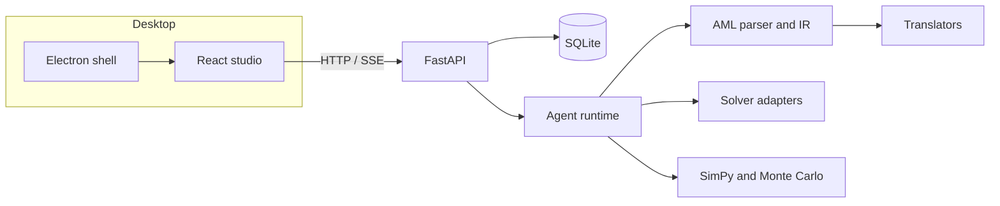

# Architecture

The studio is a React application. In the browser it talks to the API through the Vite proxy. The Electron shell starts the same API on 127.0.0.1 and, when 43124 is taken, binds an ephemeral port. The renderer asks the preload for that base before the first request and does not store the port. The packaged page is served from `axiom://local/` with relative asset URLs.

The API owns users, workspaces, projects, runs, approvals, and the audit log. Passwords are PBKDF2. Model-provider keys are Fernet-encrypted in the data directory. Nothing in the repository contains a credential.

A run is a thread. The analyst formulates AML with the offline reasoner and, when a live provider is configured, a parallel completion that is kept only if the validator accepts it. Two modelers then validate the primary model and a slack-equality alternative together. A human gate can stop the run; automatic mode records the same approval. Solvers that match the model class run concurrently. The winner is the feasible solution with the best objective. The verifier recomputes constraint slacks and compares the alternative objective. Sensitivity, scenarios, and a Monte Carlo sample run for models that are small enough to re-solve. Reports are Markdown, PDF, and Excel built from the stored result.

Open-source solvers are called in process when that is safe. OR-Tools runs in a child process because its HiGHS symbols clash with the `highspy` build used by PuLP. Gurobi and CPLEX adapters stay in the tree and report unavailable until their own packages import.
